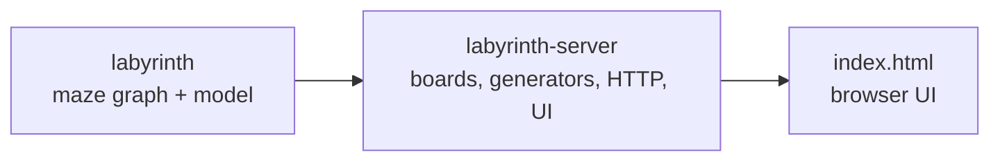
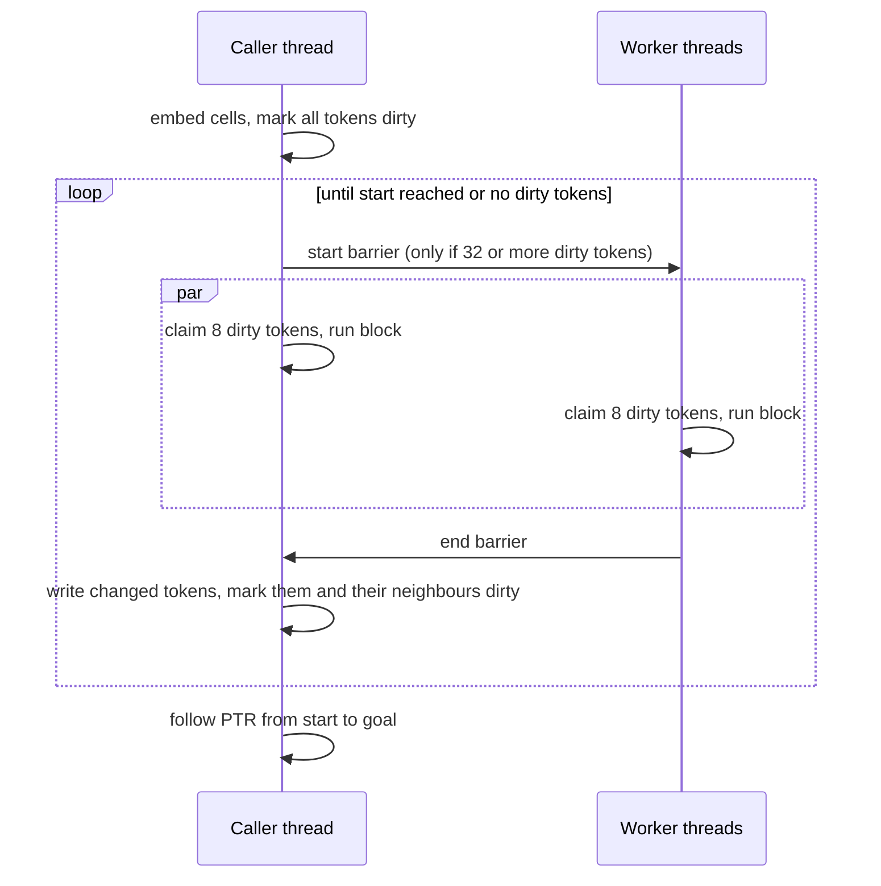
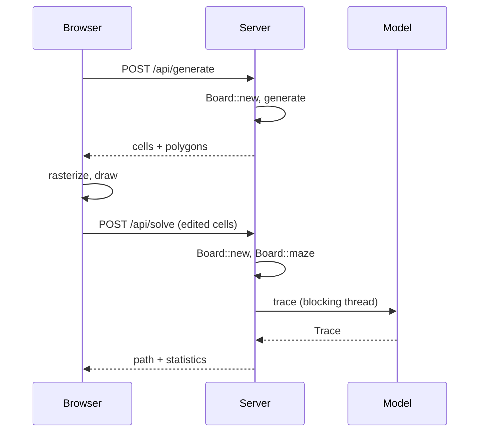

# Architecture Overview

Labyrinth is a Rust workspace with two crates.

## labyrinth (library)

| File | Content |
|------|---------|
| `src/lib.rs` | Public exports |
| `src/maze.rs` | `Maze`, `Cell`, `MazeError`, `MAX_DEGREE`, text parser |
| `src/model.rs` | `Model`, `Trace`, the weights, the solver loop, the thread pool |

The library has no geometry. A maze is cells plus edges. The neighbour
lists use compressed sparse row (CSR) storage: one `offsets` array and one
`targets` array.

### Solver loop

- The workers live for one `trace` call. A `Shutdown` guard releases
  them on all exits, including a panic.
- A worker panic is stored and raised again on the caller thread.

## labyrinth-server

| File | Content |
|------|---------|
| `server/src/main.rs` | Routes, request and response types, side limits |
| `server/src/board.rs` | `Shape`, `Board`, the tilings, the shared-edge neighbour search |
| `server/src/generate.rs` | `Algorithm`, the generators, start and goal placement |
| `server/src/index.html` | The UI: HTML, CSS and JavaScript in one file |

The binary includes `index.html` at compile time. Thus the server has no
files to install.

### Request flow

The server does not keep state between requests. It makes the board
again for each solve.

The server accepts concurrent clients. It runs up to two solves at once.
Each solve runs on a blocking thread and holds a slot until it finishes.
Maze generation also runs off the async workers. The heap counters are
process-wide, so overlapping solves can affect each other's heap statistics.

## Design decisions

| Decision | Reason |
|----------|--------|
| One looped block | The same weights work for all maze sizes |
| Attention bias from neighbour slots | The same weights work for all tilings |
| MLP steps to exact 0/1 | Errors cannot grow from loop to loop |
| Panic on no result | A wrong path is worse than a crash |
| Geometry only in the server | The library stays small and general |
| Pixel raster of cell ids in the UI | Drawing and clicks are fast on large boards |
