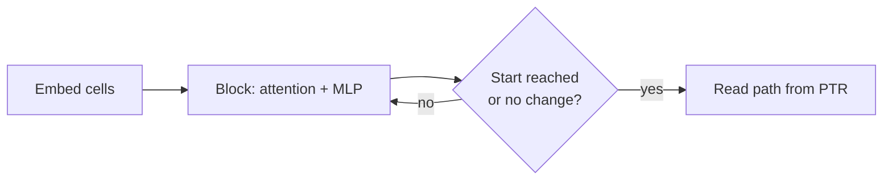

# How the Model Works

The model is a looped transformer. One block (attention and MLP) runs
again and again on the same tokens. The weights implement BFS from all goals.

`Model::new` generates the parameters from fixed rules; it does not load
trained weights or assign numeric values one by one. Each attention head is
built to copy `REACHED` from one neighbour slot. The MLP generator turns the
BFS update rules into paired ReLU units, using the maximum degree and step
sharpness constants. This produces the same 1,472 parameters for every maze.

## Tokens

Each cell is one token. A token is a vector of 20 values. This vector is
the residual stream.

| Index | Name | Meaning |
|-------|------|---------|
| 0 | `ONE` | Always 1. It acts as a bias input |
| 1 | `OPEN` | 1 if the cell is not a wall |
| 2 | `GOAL` | 1 if the cell is a goal |
| 3 | `REACHED` | 1 if the search has reached the cell |
| 4–11 | `PTR[k]` | 1 if neighbour `k` reached this cell first |
| 12–19 | `NBR_REACHED[k]` | Scratch. Attention writes neighbour `k`'s `REACHED` here |

The embedding sets `ONE`, `OPEN` and `GOAL`. All other values start at 0.

## The loop

1. The block runs on all tokens.
2. If the start has `REACHED = 1`, stop.
3. If no token changed, stop. The goals are unreachable from the start.
4. Else, go to step 1.

## Attention

The model has 8 heads. Head `k` reads neighbour slot `k` of each cell.

The score of a key is a bias. The bias depends only on the position of
the key in the neighbour list of the query:

| Key | Bias |
|-----|------|
| Neighbour in slot `k` | 0 |
| Sink token | −25 |
| Neighbour in another slot | −50 |
| Any other token | −∞ |

The sink is an extra token with all values 0. When a cell has no
neighbour in slot `k`, head `k` reads the sink. Thus it reads 0.

Each head copies the `REACHED` value of its key into `NBR_REACHED[k]`.
The difference of 25 between the bias ranks makes the leak onto the other
keys smaller than f32 resolution.

## MLP

The MLP has 27 ReLU units. Each rule is a step function over 0/1 inputs.
Two ReLU units make one step: `step(z) = relu(10(z−½)+½) − relu(10(z−½)−½)`.
The result is exactly 0 for `z ≤ 0.45` and exactly 1 for `z ≥ 0.55`.

The rules:

1. **Reached.** `REACHED ← GOAL or (OPEN and any NBR_REACHED)`.
   A wall never becomes reached.
2. **Pointer.** `PTR[d] ← 1` when all these are true:
   - the cell is open,
   - the cell is not a goal,
   - the cell was not reached before this loop,
   - `NBR_REACHED[d]` is 1,
   - `NBR_REACHED[e]` is 0 for each `e < d`.

   Thus the first reached neighbour wins.
3. **Clear.** The MLP subtracts the old `REACHED` and all `NBR_REACHED`
   values. The rules above write the new values.

## Path readout

A cell gets its pointer in the loop in which the search first reaches it.
The pointer goes to a neighbour that the search reached one loop before.
Thus each pointer goes one BFS layer nearer to a goal.

The solver starts at the start cell, follows the pointer chain to the nearest
goal, then joins shortest paths to the remaining goals in nearest-unvisited
order. It returns no route if any goal is unreachable.

## Parameter count

| Part | Count | Calculation |
|------|-------|-------------|
| Attention | 392 | 8 heads × (9 biases + 20 value weights + 20 output weights) |
| MLP | 1,080 | 27 units × (20 input weights + 20 output weights) |
| **Total** | **1,472** | |

## Skipped work

The output of a token depends only on the token and its neighbours. If
none of them changed in the last loop, the output is the same. Thus the
solver evaluates only the tokens near a change. This does not change the
result. It changes the time for each loop from the size of the maze to the
size of the search front.
