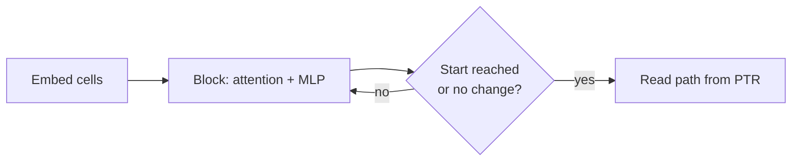

# How the Model Works

`Model::trace` applies fixed BFS rules directly to cells and records the
search progress. It does not construct or execute transformer weights. Each
cell's runtime state is one byte: `0` means unreached, `1`–`8` identify the
neighbour that first reached it, and `9` marks a goal. The trace floods
outward from all goals, updates only dirty cells, then builds a route from the
start through every goal.

`Model::solve` returns the same route without producing trace data. It has
two strategies:

- **Open square.** A single-goal, fully open square grid gets a
  Manhattan-shortest route built directly, using cached neighbour-order
  preferences to resolve ties.
- **Waves.** Otherwise, waves grow from the start and from every goal until
  they meet; see [Single-goal search](#single-goal-search). The route runs to
  the goal that was reached. With several goals, `solve` then runs one queue
  BFS leg to the nearest unvisited goal at a time, as `trace` does.

`Transformer` evaluates the 1,472-parameter block described below without storing
its matrices densely. Construction precomputes the structural softmax weights;
the forward pass accumulates all eight heads together and shares projections
between paired ReLUs and prefix sums between pointer units. Its `Solver`
implementation evaluates the block on every cell in every iteration, without
the open-square or wave shortcuts. For each subsequent leg, it re-embeds the
maze with only the unvisited goals flagged. `Model::parameter_count()` reports
the same count without constructing those weights.

## Single-goal search

`Model::solve` grows whole BFS waves from the goal and from the start. Each
step widens whichever frontier is smaller; on a tie it widens the start side.
The search returns no route when either frontier runs empty.

- **Goal side.** Each newly reached cell stores the same pointer `trace`
  would give it: the lowest neighbour slot that the previous goal wave
  reached. A pending bit, set while a wave is being built, stops a cell from
  pointing at another cell of the same wave.
- **Start side.** Each cell stores a flag, its depth from the start modulo 3,
  and a tie bit. The tie bit is set when a second cell of the previous wave
  also reaches it. The search also keeps every start-side cell in wave order,
  with each cell's parent recorded as an index into that list. Both lists are
  reserved for every cell up front, 12 bytes per cell.

The search stops as soon as one side touches the other. The meeting cells are
the cells of the last start-side wave that touch a settled goal-side cell.

`trace` follows, from every cell, the lowest neighbour slot one step nearer
the goal. To return that same route, `solve` rebuilds the start-side part in
one of two ways:

1. **Parent chain.** This applies when there is exactly one meeting cell and
   no cell on its parent chain carries the tie bit. Then only one shortest
   route reaches the meeting cell, and `solve` reads it back with one load per
   step.
2. **Marked walk.** Otherwise, `solve` walks back from the meeting cells one
   depth at a time. At each step it marks as on route every neighbour that
   carries the depth tag one level nearer the start. It then walks forward
   from the start, each step taking the lowest neighbour slot that is marked
   and one level deeper.

From the last start-side cell, the route steps to its lowest-slot goal-side
neighbour and follows the goal-side pointers to the goal. On backtracker
mazes this is several times faster than flooding from the goal alone; see
[Performance Results](performance.md#comparing-solve-algorithms).

## Equivalent transformer

One block (attention and MLP) runs again and again on the same tokens. Its
fixed weights implement BFS from all goals.

## Tokens

In the equivalent transformer, each cell is a token. A token is a vector of
20 values. This vector is the residual stream.

| Index | Name | Meaning |
|-------|------|---------|
| 0 | `ONE` | Always 1. It acts as a bias input |
| 1 | `OPEN` | 1 if the cell is not a wall |
| 2 | `GOAL` | 1 if the cell is a goal |
| 3 | `REACHED` | 1 if the search has reached the cell |
| 4–11 | `PTR[k]` | 1 if neighbour `k` reached this cell first |
| 12–19 | `NBR_REACHED[k]` | Scratch. Attention writes neighbour `k`'s `REACHED` here |

The embedding sets `ONE`, `OPEN` and `GOAL`. All other values start at 0.

## Equivalent transformer loop

1. The block runs on all tokens.
2. If the start has `REACHED = 1`, stop.
3. If no token changed, stop. The start is unreachable from every goal.
4. Else, go to step 1.

## Equivalent attention

The model has 8 heads. Head `k` reads neighbour slot `k` of each cell.

The score of a key is a bias. The bias depends only on the position of
the key in the neighbour list of the query:

| Key | Bias |
|-----|------|
| Neighbour in slot `k` | 0 |
| Sink token | −25 |
| Neighbour in another slot | −50 |
| Any other token | −∞ |

The sink is an extra token with all values 0. A head writes the
softmax-weighted sum of its keys' `REACHED` values into `NBR_REACHED[k]`.
With no neighbour in slot `k`, the sink gets the largest weight. The
other keys can still contribute a small nonzero value, but the 25-point
bias gap keeps that leakage below the MLP's decision threshold.

## Equivalent MLP

The MLP has 27 ReLU units. Each rule is a step function over 0/1 inputs.
Two ReLU units make one step: `step(z) = relu(10(z−½)+½) − relu(10(z−½)−½)`.
The result is exactly 0 for `z ≤ 0.45` and exactly 1 for `z ≥ 0.55`.

The rules:

1. **Reached.** `REACHED ← GOAL or (OPEN and any NBR_REACHED)`.
   A wall never becomes reached.
2. **Pointer.** `PTR[d] ← 1` when all these are true:
   - the cell is open,
   - the cell is not a goal,
   - the cell was not reached before this loop,
   - `NBR_REACHED[d]` is 1,
   - `NBR_REACHED[e]` is 0 for each `e < d`.

   Thus the first reached neighbour wins.
3. **Clear.** The MLP subtracts the old `REACHED` and all `NBR_REACHED`
   values. The rules above write the new values.

## Equivalent path readout

A cell gets its pointer in the loop in which the search first reaches it.
The pointer goes to a neighbour that the search reached one loop before.
Thus each pointer goes one BFS layer nearer to a goal.

The trace starts at the start cell, follows the pointer chain to the nearest
goal, then joins shortest paths to the remaining goals in nearest-unvisited
order. It returns no route if any goal is unreachable.

## Equivalent parameter count

| Part | Count | Calculation |
|------|-------|-------------|
| Attention | 392 | 8 heads × (9 biases + 20 value weights + 20 output weights) |
| MLP | 1,080 | 27 units × (20 input weights + 20 output weights) |
| **Total** | **1,472** | |

## Skipped work

The output of a token depends only on the token and its neighbours. If
none of them changed in the last loop, the output is the same. Thus
`Model::trace` evaluates only tokens near a change. This does not change the
result. It changes the time for each loop from the size of the maze to the
size of the search front.
