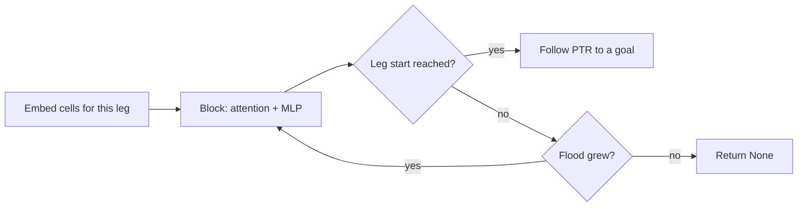

# How the Model Works

## Which route is returned?

A route is a list of cell IDs, starting at `S`. Each leg takes a shortest
path through non-wall cells to the nearest unvisited goal, measured in edges.
If several moves can begin such a path, take the first in the current cell's
neighbour list (`Maze::new` preserves input edge order). This breaks ties
between goals as well as between paths to one goal. The next leg starts at the
goal just visited; it may cross earlier parts of the route. This greedy rule
does **not** promise the shortest tour of all goals. If any goal is unreachable,
the result is `None`, not a partial route.

`Model::trace`, `Model::solve`, and `Transformer::solve` produce the same
route. They differ in how they find it and what work they record.

## Tracing the first leg

`Model::trace` runs a breadth-first search (BFS) from **all goals at once**.
It uses one state byte per cell, not transformer weights: `0` is unreached,
`1`–`8` point to neighbour slots `0`–`7`, and `9` marks a reached goal.
The first loop evaluates every cell and marks the goals. In each later loop
an unreached open cell takes the lowest slot pointing to a previously reached
neighbour. Updates take effect together, so the flood advances one edge per
loop. Only changed cells and their neighbours are scheduled for the next loop.

The flood stops once it reaches `S` or a loop makes no changes. `loops` counts
these iterations, `token_passes` counts cell evaluations, and `reached_at`
records the first loop in which each cell changed. A goal has `Some(1)`;
`None` can mean the flood stopped before reaching that cell, not just that the
cell was unreachable.

Following the pointers from `S` gives the first leg. For each later leg both
`Model` methods use an ordinary queue BFS *from the last goal*, exploring
neighbours in slot order and stopping at the first unvisited goal dequeued.
`Trace::path` includes those legs when successful; the three trace statistics
describe only the initial flood.

## Optimized solve

`Model::solve` skips trace collection. With one goal on a fully open,
row-major square grid, it constructs the Manhattan-shortest path directly.
`Maze` has already checked the grid edges and cached each cell's vertical vs.
horizontal preference, so ties match the neighbour order. Every other maze
uses the wave search below for its first leg, even when it has several goals.

### Bidirectional search for the first leg

The general first-leg search grows a frontier from the start and another
from **all** goals. Each step widens the smaller frontier; on a tie it widens
the start side. If either frontier runs empty before contact, no route exists.

- **Goal side.** Each newly reached cell stores the same pointer `trace`
  would give it: the lowest neighbour slot that the previous goal wave
  reached. A pending bit, set while a wave is being built, stops a cell from
  pointing at another cell of the same wave.
- **Start side.** Each cell stores a flag, its depth from the start modulo 3,
  and a tie bit. The tie bit is set when a second cell of the previous wave
  also reaches it. Start-side cells are kept in wave order with an index
  pointing back to the parent that first reached each one.

The search stops as soon as one side touches the other. The meeting cells are
the cells of the last start-side wave that touch a settled goal-side cell.

On the first leg, `trace` follows the lowest neighbour slot one step nearer
to a goal. To return that same route, `solve` rebuilds the start-side part in
one of two ways:

1. **Parent chain.** This applies when there is exactly one meeting cell and
   no cell on its parent chain carries the tie bit. Then only one shortest
   route reaches the meeting cell, and `solve` follows the recorded parents.
2. **Marked walk.** Otherwise, `solve` walks back from the meeting cells one
   depth at a time. At each step it marks as on route every neighbour that
   carries the depth tag one level nearer the start. It then walks forward
   from the start, each step taking the lowest neighbour slot that is marked
   and one level deeper.

From the last start-side cell, the route steps to its lowest-slot goal-side
neighbour and follows the goal-side pointers to a goal.

## Equivalent transformer

`Transformer` is a separate `Solver` implementation that evaluates a fixed
floating-point attention and ReLU block. Each iteration runs the block on
**every** cell. Each leg is a new flood from the still-unvisited goals,
without `Model`'s direct path, bidirectional waves, or queue BFS.

### Tokens

In the equivalent transformer, each cell is a token. A token is a vector of
20 values. This vector is the residual stream.

| Index | Name | Meaning |
|-------|------|---------|
| 0 | `ONE` | Always 1. It acts as a bias input |
| 1 | `OPEN` | 1 if the cell is not a wall |
| 2 | `GOAL` | 1 if the cell is a goal still to visit |
| 3 | `REACHED` | 1 if the search has reached the cell |
| 4–11 | `PTR[k]` | 1 if slot `k` was selected when this cell was first reached |
| 12–19 | `NBR_REACHED[k]` | Scratch for head `k`'s weighted neighbour read |

The embedding sets `ONE`, `OPEN` and `GOAL`. All other values start at 0.

### Equivalent transformer loop

The start of a leg is `S` or the last goal visited. Once reached, follow its
pointers to the next goal: each pointer goes one BFS layer nearer. Append the
cells traversed without repeating the join. Before the next leg, clear the
visited goal's `GOAL` flag and reset the dynamic state. The neighbour graph
and the weights stay the same.

### Equivalent attention

The model has 8 heads. Head `k` reads neighbour slot `k` of each cell.

The score of a key is a bias. The bias depends only on the position of
the key in the neighbour list of the query:

| Key | Bias |
|-----|------|
| Neighbour in slot `k` | 0 |
| Sink token | −25 |
| Neighbour in another slot | −50 |
| Any other token | −∞ |

The sink has zero value. A head writes the softmax-weighted sum of its keys'
`REACHED` values into `NBR_REACHED[k]`. With no neighbour in slot `k`, the
sink gets the largest weight. The other keys can contribute a small nonzero
value, but the 25-point gap keeps that leakage below the MLP threshold.
Since the scores depend only on the cell's degree, key slot and head,
`Transformer::new` precomputes their normalized weights once. The sink is
included in the denominator; it needs no separate multiply in the forward pass.

### Equivalent MLP

Of the MLP's 27 ReLU units, 18 implement nine threshold tests (one for
`REACHED`, eight for the pointers). The other nine clear the old reached
value and the eight scratch values.
Two ReLU units make one step: `step(z) = relu(10(z−½)+½) − relu(10(z−½)−½)`.
The result is exactly 0 for `z ≤ 0.45` and exactly 1 for `z ≥ 0.55`.

The rules:

1. **Reached.** `REACHED ← GOAL or (OPEN and any NBR_REACHED)`.
   A wall never becomes reached.
2. **Pointer.** `PTR[d] ← 1` when all these are true:
   - the cell is open,
   - the cell is not a goal,
   - the cell was not reached before this loop,
   - `NBR_REACHED[d]` indicates a reached neighbour,
   - no earlier slot `e < d` indicates one.

   Thus the lowest eligible slot wins. Its pointer persists in later loops.
   The numerical block shares a projection between each pair of ReLUs and
   uses a running sum of earlier heads for the pointer tests.
3. **Clear.** The MLP subtracts the old `REACHED` and the attention scratch
   from the residual stream. Only the new `REACHED` and the pointers carry
   search progress into the next loop.

### Equivalent parameter count

| Part | Count | Calculation |
|------|-------|-------------|
| Attention | 392 | 8 heads × (9 biases + 20 value weights + 20 output weights) |
| MLP | 1,080 | 27 units × (20 input weights + 20 output weights) |
| **Total** | **1,472** | |

This counts the equivalent dense projections, including fixed zero weights,
not the number of floats stored at runtime. `Model::parameter_count()`
computes the count without constructing a `Transformer`.

### Numerical execution layouts

`Transformer::solve` selects its layout once per solve. On x86-64 with AVX2
and at most `i32::MAX` cells (so the gather indices, including the sentinel,
fit), each vector lane represents one of eight consecutive cells. A batch
packs neighbour indices up to its highest degree; missing slots gather a
zero from the sentinel. The eight heads read from one `REACHED` buffer while
the next layer is written to another. Open flags, goal flags and pointers
are stored separately.

`WallSkippingTransformer::solve` uses the same block but never updates a
wall: its `REACHED` value and pointers are zero on every layer. Its AVX2
kernel packs eight traversable cells per vector (padding the last batch)
and maps wall neighbours to the zero sentinel without changing any cell's
degree or slot order. The returned path uses the original maze cell IDs.

The packer builds this layout once for all loops and legs. Two batches with
the same **ordered tuple of eight degrees** can share weight rows even if
their neighbour IDs differ: the IDs determine *where* to read and the degrees
determine *how much* each head weights the result. Reuse saves space, but a
layer that jumps between distant rows can be slower than a sequential scan.
Two checks balance these costs during packing:

- After the packed table grows past 8 MiB and at each further 64 KiB growth
  window, keep the pattern lookup if hits within 64 KiB of the write position
  saved at least half a window's worth of rows. Otherwise clear the lookup.
- Above 8 MiB, count reuse hits that jump more than 64 KiB from the preceding
  batch's offset. If more than 32 such hits occur in a 64-batch sample, clear
  the lookup and begin a fresh 64 KiB growth window. This catches scattered
  reads even when reuse has stopped the table from growing.

Clearing the lookup affects **future** batches only: they can append new rows
nearby. Rows already referenced by packed batches remain valid. These are
layout choices, not changes to the weights or the search rules.

On other targets, without AVX2, or beyond the signed index limit, the
portable kernel keeps two buffers of 20-float tokens. For each cell it reads
its actual neighbours, accumulates all eight heads using the precomputed
weights, and writes the updated token into the other buffer. Both layouts
evaluate the same block and use the same pointer readout.

See [Performance Results](performance.md) for measured solve times.
