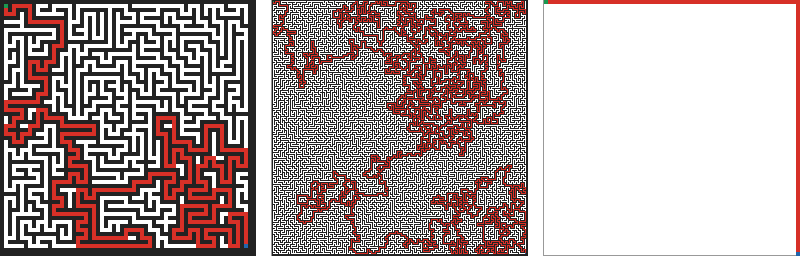
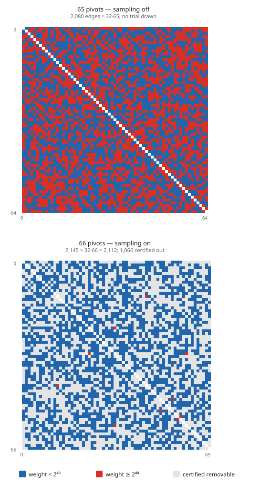

## One routing rule

Consider a maze solver that can ask each cell only about its immediate neighbours. A cell beside a goal can learn which way to move in one exchange. A cell two steps away needs another exchange, but it need not learn the whole path: it need only remember which neighbour knew the answer first. This observation gives both a construction for a transformer and a reason to expect classical breadth-first search (BFS) [@moore59] to do less work.

The input is an undirected, unweighted graph with walls and at most eight neighbours per cell. Neighbour lists have a fixed order. Each leg goes to the nearest unvisited goal. Among equally short choices, take the lowest neighbour slot that moves one step closer to any such goal. This settles ties between goals as well as between paths. A leg may cross an earlier leg; the result is not necessarily a shortest tour. An unreachable goal means failure, not a partial route.

`Transformer::solve` evaluates numerical attention and feed-forward layers on every cell. `WallSkippingTransformer::solve` evaluates the same block only on traversable cells. `Model::solve` searches the graph without evaluating a layer. The rule defines the answer independently of these choices: we can compare exact routes without requiring the implementations to visit the same cells in the same order.

## Building a search out of attention

**What a cell can read.** Each cell is a token with 20 values: a constant, open and goal flags, a reached flag, eight pointer bits and eight scratch values. The graph supplies the attention mask and the neighbour-slot order. Rather than learn a useful head from examples, we assign one head to each slot. This uses attention [@vaswani17] as a programmable operation [@weiss21], not as a predictor of which corridor looks promising.

Head *k* assigns score 0 to the neighbour in slot *k*, −50 to other neighbours and −25 to a zero-valued sink; all other cells are masked. Its output is the softmax-weighted sum of the neighbours' previous reached flags. If slot *k* exists, its neighbour dominates. If not, the sink dominates: other neighbours may contribute a small nonzero value, but not enough to pass the next threshold. Normalized weights depend only on degree, slot and head, so the implementation computes them once rather than evaluating a softmax at every cell and layer.

**What a cell can remember.** A pair of ReLUs makes a threshold with flat regions on both sides:

$$ T(z)=\operatorname{relu}(10z-4.5)-\operatorname{relu}(10z-5.5). $$

The output is exactly zero below 0.45 and exactly one above 0.55. Nine such pairs implement one reached test and eight pointer tests. A goal becomes reached; an open cell becomes reached when any neighbour was reached in the preceding layer. A newly reached non-goal cell sets pointer *k* only if head *k* reads a reached neighbour and no lower slot does. The pointer then persists. Nine more units remove the previous reached value and scratch from the residual stream. The block has 392 attention parameters (eight heads with nine biases and two 20-value projections each) and 1,080 MLP parameters (27 units with two 20-value projections each). This counts fixed zero weights, not floats allocated at run time.

**Why the readout gives a shortest path.** Initially no cell is reached. The first layer marks the goals. If the reached set after a layer is the set within distance *r* of a goal, then the next layer adds precisely the open cells at distance *r* + 1: each has a neighbour in the old set, and no more distant cell does. A pointer chosen on first arrival therefore reduces distance by exactly one. Following pointers from the start terminates at a nearest goal, choosing the lowest eligible slot at every step. For example, if two corridors of equal length leave the start through slots 2 and 5, their signals arrive together; slot 2 wins even if slot 5 leads to a lower-numbered goal.

Once the start is reached, the solver reads out that leg, removes its goal, resets dynamic state and runs the block again from the remaining goals. If a layer adds nothing before reaching the leg start, no path exists. Every layer evaluates every cell, including walls. For *N* cells and a reachable leg of *d* edges, this costs *N(d + 1)* cell updates at bounded degree, before readout. Local attention avoids an all-pairs score matrix; it does not avoid rescanning cells that have nothing new to say.

## Where work can be removed

**Keep the layers; change their layout.** The portable transformer reads previous-layer tokens and writes a separate next layer. On x86-64 with AVX2 and indices that fit a signed 32-bit gather, each vector lane instead holds one of eight consecutive cells. Neighbour IDs tell a lane where to gather; the ordered degrees of the eight cells determine the weights. Batches with different neighbours can therefore share weight rows. The packer limits reuse when consecutive reads would jump between distant rows. It packs once per solve, but uses the layout for every layer and leg.

An earlier paired comparison on 16² and 32² boards found full solves 4.0–5.7 times faster with SIMD across cells than across heads. Both kernels evaluated the same cells. Weight sharing addresses a different cost: on a 512² open board only six ordered degree patterns occurred, requiring 5.25 KiB of shared weights instead of nearly 32 MiB of per-batch weights. These comparisons are between numerical kernels, not against BFS.

**Keep the layers; omit wall updates.** A wall starts unreached and the open-cell gate prevents it from ever becoming reached. The wall-skipping transformer can therefore substitute zero whenever a cell reads a wall. It retains the wall's neighbour slot and attention weight: deleting the slot would change the softmax and could shift a later neighbour into the wrong head. The AVX2 implementation packs traversable cells once per solve and maps pointers back to the original cell IDs at readout. If *P* cells are traversable, each leg now requires *P(d + 1)* cell updates instead of *N(d + 1)*. This is not frontier search: even a traversable cell whose value cannot yet change is evaluated every layer.

**Keep the routing rule; change the algorithm.** The key observation is that after a layer, only a newly reached cell can bring news to an unreached neighbour. `Model::trace` makes that observation explicit: for its first leg it schedules changed cells and their neighbours, storing a goal or pointer in one byte instead of evaluating attention. It exposes the wave history. Neither solve method calls the other, and the trace is not a third numerical kernel.

`Model::solve` needs only the path. On the general first leg it grows complete BFS layers from the start and from all unvisited goals, expanding the smaller frontier [@pohl71]. When the waves meet, settled goal-side pointers already lead downhill to a nearest goal. On the start side, a single meeting cell with an untied parent chain gives a unique prefix. Otherwise the solver marks predecessors backward from all shortest meeting points, then walks forward choosing the lowest marked slot one level deeper. Adjacent BFS depths differ by at most one, so depth modulo three distinguishes a predecessor from a peer or a successor. This reconstructs the same route without computing a reached value for every cell at every distance. Later legs use slot-ordered queue BFS to the nearest remaining goal.

Geometry can remove the search itself. For one goal on a fully open square grid, a move toward the goal along either differing coordinate reduces Manhattan distance by one. Maze construction caches the slot preference for that choice; solving then costs one step per output edge. This shortcut belongs only to the classical implementation.

Figure: A backtracker has a unique route between two cells; an open square can have many shortest routes. On the square shown, slot order selects the top row and then the right edge. {#fig:mazes}

## Comparing the implementations

**A shared sweep.** We ran six methods on the same open squares, seed-1 recursive backtrackers [@buck15], and those backtrackers with three added goals. Sides doubled from 16 to 1024: 21 boards and 126 timings. The release build ran on an AMD Ryzen AI 9 HX 370 under Linux, pinned to logical CPU 2, with runtime-selected AVX2. Each timing is one calibrated batch, not a median of repeated samples. The first solve sets the repeat count for a target of 10 ms and counts toward the batch; slow solves run once. Timings include packing and path construction, but exclude maze and solver construction and route checking.

Slot-ordered queue BFS supplies the reference route, stopping at the nearest unvisited goal on each leg. Both transformers and `Model::solve` must match it exactly. The other baselines, bidirectional BFS and Manhattan A* [@hart68], may choose a different shortest path on single-goal boards; we check endpoints, edges, traversability and shortest length. On the four-goal trees they search each remaining target, choose the shortest leg with ties broken by slot order, and must match the full reference route. Target selection is timed, not supplied by the reference.

Table: Numerical solve times on four-goal backtrackers, in seconds. Edges count the entire route, including revisits. {#tab:numerical}

| Side | Edges | Dense | Wall-skipping |
|-----:|------:|------:|--------------:|
| 16 | 68 | 0.000064 | 0.000028 |
| 32 | 252 | 0.000662 | 0.000282 |
| 64 | 1,584 | 0.0168 | 0.00752 |
| 128 | 2,900 | 0.129 | 0.0568 |
| 256 | 14,164 | 2.57 | 1.19 |
| 512 | 55,516 | 46.3 | 19.4 |
| 1024 | 153,472 | 582.8 | 260.2 |

Wall skipping cut the numerical solve time by more than half at every size on these four-goal boards, without changing a pointer choice. The open square provides a control: there are no wall updates to omit. At 1024² the dense and wall-skipping solves took 7.94 and 7.68 s for 2,046 edges. On the single-goal backtracker of the same size, the route was 68,176 edges and the times were 266.7 and 122.5 s. Token count alone does not predict solve time: the longer corridor requires more synchronous layers.

Table: Classical methods on the same 1024² boards, in milliseconds. “Model” denotes the classical path-only implementation. {#tab:classic}

| Board | Model | Queue BFS | Bidir. BFS | A* |
|-------|------:|----------:|-----------:|---:|
| Open | 0.00116 | 24.45 | 25.45 | 43.25 |
| Backtracker | 13.15 | 16.51 | 18.50 | 23.62 |
| Four goals | 54.00 | 60.50 | 152.99 | 281.19 |

The open-square result measures direct geometric path construction, not faster frontier expansion. On the four-goal board even ordinary queue BFS takes only 60.5 ms: it visits a frontier instead of evaluating every traversable cell at every distance. Its comparison with A* and bidirectional BFS includes the latter methods' separate searches for candidate targets. It is not a comparison of single-target search kernels alone.

**What if we compute every distance before choosing a path?** Gholami and Hajiaghayi [@gh26] solve a different problem: given an undirected graph with nonnegative edge lengths, return distances and a shortest-path tree from one source to every reachable vertex. At every maze size we support, Algorithm 8 selects its scan-based Dijkstra base case (lines 3–6), not its randomized hierarchy. For each leg we run the scan to completion, then construct the tree by following *tight* edges: on a unit-edge maze these go from distance *k* to distance *k* + 1. Visiting them in queue and neighbour-slot order selects the same nearest goal and path as our reference BFS.

Table: Separate seven-method experiment. Selected median times in µs per complete solve, five rotated calibrated batches per board on CPU 2; backtracker seed 1. {#tab:scan}

| Side | Board | Scan base case | Queue BFS | Model |
|-----:|-------|---------------:|----------:|------:|
| 32 | Open | 26.955 | 4.740 | 0.045 |
| 32 | Backtracker | 6.179 | 1.634 | 1.634 |
| 32 | Four goals | 25.043 | 3.468 | 2.972 |
| 64 | Open | 119.494 | 17.663 | 0.105 |
| 64 | Backtracker | 28.949 | 6.462 | 6.982 |
| 64 | Four goals | 156.231 | 25.144 | 22.698 |

The scan base case returned the reference route on all six boards and took 3.8–7.2 times as long as queue BFS (ratios of per-board medians). These measurements do not test the weighted hierarchy. The tight-edge criterion is useful here, but neither solver needs a separate tree pass: the classical model already follows consecutive BFS levels to resolve tied prefixes, and the transformer records the first eligible downhill slot when the wave arrives. Reconstructing a full tree afterward would not eliminate a single propagation layer.

**What if we lower the cutoff?** In a separate experiment we set both the base-case cutoff and the separator size to eight, retaining the sampling rule of Algorithm 5 [@gh26]. The unit-edge implementation partitions each source component into connected cells around pivots. It builds inward and outward states for travel within a cell and uses macro edges to cross between cells. With only one positive weight scale, it processes states in integer distance order, respecting zero-length transitions within each distance. Both full-source methods rebuild their distance map and recover the route on each leg; queue BFS can stop when it finds the next goal.

Table: Lowered-cutoff experiment, µs per complete solve on CPU 2, including hierarchy construction. Each board uses the median of five calibrated batches with rotated method order. Backtracker and four-goal rows report the median of those medians over seeds 1–3; each open row uses one deterministic board. {#tab:cutoff}

| Side | Board | Queue BFS | Scan base | Hierarchy |
|-----:|-------|----------:|----------:|----------:|
| 32 | Open | 6.40 | 31.08 | 254.79 |
| 32 | Backtracker | 1.22 | 5.95 | 61.10 |
| 32 | Four goals | 3.39 | 24.17 | 282.52 |
| 64 | Open | 17.79 | 118.68 | 874.42 |
| 64 | Backtracker | 6.51 | 28.50 | 434.76 |
| 64 | Four goals | 19.88 | 172.14 | 1,885.95 |
| 128 | Open | 79.18 | 800.39 | 3,977.08 |
| 128 | Backtracker | 29.17 | 236.13 | 2,260.41 |
| 128 | Four goals | 77.07 | 1,142.04 | 9,191.60 |

On all 21 boards, hierarchy distances from the start and each goal matched the scan base case, and complete routes matched queue BFS. Comparing medians on each individual board, the hierarchy took 5.0–15.6 times as long as the scan and 38.5–225.4 times as long as BFS. On the 128² open board, for example, 16,384 traversable cells became 61,440 states before distance evaluation.

Lowering the cutoff exercised hierarchy construction, **not random sampling**. Contracting connected owner cells in a planar maze and removing loops and duplicate edges leaves a simple planar graph. With *t* pivots it has fewer than *3t* distinct edges; Algorithm 5 samples only above *32t*. The timings therefore measure the cost of this unit-edge specialization, not the performance of randomized sampling on dense weighted graphs.

## When the graph is dense and weighted

**Can sampling remove useful work?** To cross the threshold that planar mazes cannot reach, we used complete undirected graphs with one pivot per vertex. Each edge independently receives an integer weight from 1 to 16, with probability one half of adding 2⁴⁰. This deliberately gives expensive direct edges cheap competing routes. At 65 vertices the 2,080 edges equal the sampling threshold; at 66 the 2,145 edges exceed it. Above threshold, Algorithm 5 draws *16t* distinct edges and uses Algorithm 6's distance estimates to name routes [@gh26]. We remove an edge only when its certificate implies a strictly cheaper detour. This tests the naming and filtering stages followed by Dijkstra, not the full weighted Algorithm 8.

Figure: Each off-diagonal square is an edge in the seed-1 fixture, with vertices in ID order on both axes. Blue edges weigh less than 2⁴⁰ and red edges more. Pale squares are certified deletions, not missing input edges; at 65 pivots none are certified. Both inputs are complete. {#fig:weighted}

Table: Full shortest-path tree, µs. Scan and Heap use the original graph. Off and On include naming, filtering and heap search, with sampling disabled or permitted. Reuse times just the heap search on the already-filtered graph. {#tab:weightedtree}

| Vertices | Scan | Heap | Off | On | Reuse |
|----:|----:|----:|----:|----:|----:|
| 65 | 3.17 | 3.57 | 39.29 | 31.79 | 3.59 |
| 66 | 3.42 | 3.71 | 53.28 | 467.28 | 2.51 |
| 128 | 13.26 | 12.29 | 449.73 | 1,197.07 | 7.15 |
| 256 | 48.88 | 41.65 | 1,973.93 | 3,531.27 | 26.02 |

Both weighted experiments used the same 12 graphs (three seeds per size), on CPU 2 with GCC 16.2.1 at `-O3`. Each entry is the median of three graph-specific medians, each over nine source queries with rotated method order and calibrated batches. All 81 above-threshold trials accepted the first draw; the median fraction of edges removed at each size was 49.5–49.9%. At 65 vertices both naming modes take the same terminal branch, so their timing difference is not a sampling effect. Full-source distances matched Floyd–Warshall, and each predecessor edge realized its reported distance.

**What if we need only one route?** The fixed-weight transformer and production `Model` accept neither these degrees nor these edge weights. We transferred the classical model's *routing rule*, not its BFS implementation: run Dijkstra from the goal until it settles the start, then take the first neighbour in slot order satisfying d(x) = w(x,y) + d(y). Positive weights ensure that every such neighbour already has its final distance and that the walk terminates. This avoids constructing the full tree. Forward heap Dijkstra instead stops at the goal and reconstructs its parent chain; it need not select the same tied route.

Table: Single-goal time in µs, including path construction. Forward uses a heap; Heap and Scan implement the weighted model on the original graph. Build includes naming, filtering and the model's heap search; Reuse excludes preprocessing. {#tab:weightedroute}

| Vertices | Forward | Heap | Scan | Build | Reuse |
|----:|----:|----:|----:|----:|----:|
| 65 | 2.02 | 1.76 | 1.82 | 31.73 | 1.81 |
| 66 | 1.72 | 1.34 | 1.19 | 438.83 | 0.86 |
| 128 | 7.73 | 4.93 | 6.48 | 1,173.37 | 3.07 |
| 256 | 17.84 | 10.91 | 15.86 | 3,584.06 | 6.77 |

All methods answered the same 108 source–goal queries, with at least 5 ms per timed batch and validation outside timing. Every ordered variant matched the exact slot-ordered route derived from Floyd–Warshall distances. Forward search found the same minimum cost but returned a different tied route on 30 queries. Above threshold, heap search on the filtered graph took 62–65% of the original ordered heap time; building the filter for one query instead took 244–341 times the unfiltered solve time (paired ratios, aggregated as for the timings). Preprocessing bought cheaper subsequent queries, not a cheaper first answer. Searching backward and forward settles different vertices; these samples do not establish a general advantage for either direction.

## Scope and implications

The transformer demonstrates exact search with hand-set weights, not learning or generalization from training data. It assumes local graph connectivity, bounded degree and a supplied slot order. All experiments use one CPU. The six-method maze sweep uses one backtracker seed and one calibrated sample per method and board; the seven-method comparison uses the same seed. The lowered-cutoff and dense weighted experiments vary seeds. Small timing differences do not establish a reliable ranking. Backtrackers are trees, so their single-goal timings do not measure the cost of resolving competing shortest prefixes in cyclic mazes. The weighted prototype tests single-goal routes on one synthetic weight distribution, not numerical transformer layers. Neither these measurements nor the fixed parameter count establishes a performance bound on other hardware.

The useful distinction is between the information a path needs and the work an implementation performs to obtain it. Attention and a threshold block suffice to propagate distance one edge at a time and leave a readable route. When those numerical layers are the object of study, vectorizing across cells makes them cheaper without changing the computation. When the route is the object of study, a frontier carries the same new information without touching every token, and sometimes geometry supplies the answer without a frontier at all.
